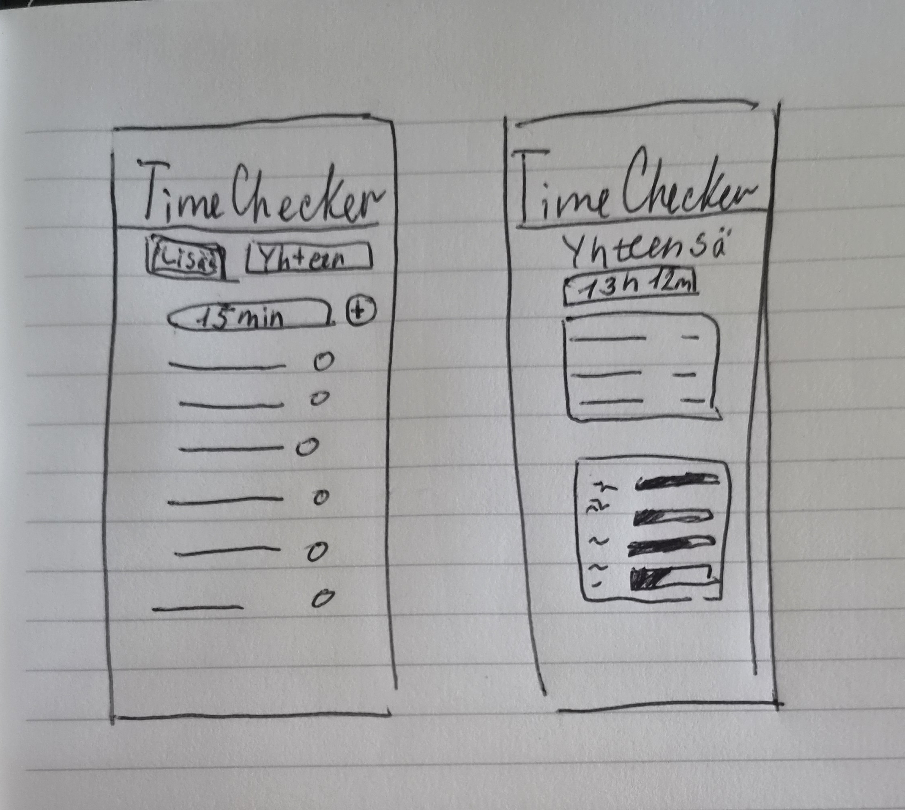
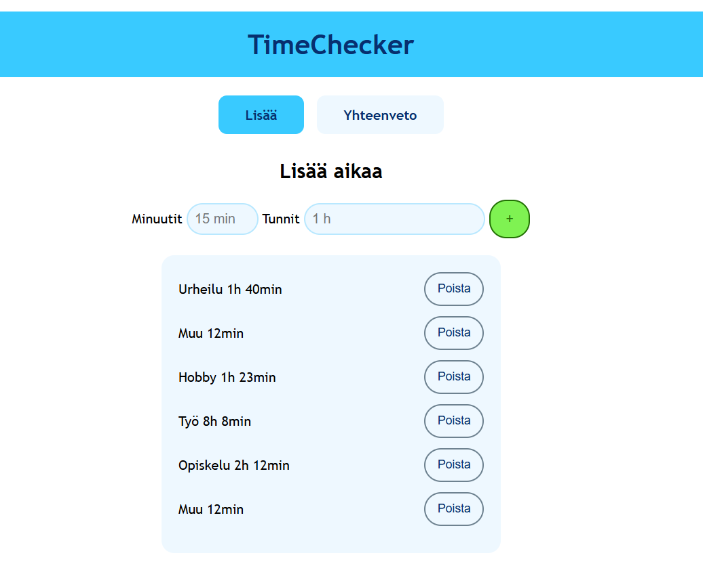

# TimeChecker

**Tekijä(t):** Lidiia Molodtsova

## Projektisuunnitelma

### Projektin idea

TimeChecker on ajanseurantasovellus. Tämän sovelluksen avulla käyttäjä voi seurata, miten hän käyttää aikaansa. Käyttäjä voi lisätä aikaa eri kategorioihin. Sovellus näyttää kokonaisajan sekä ajan jokaisessa kategoriassa. Se näyttää myös ajankäytön prosentteina.

Sovellus on tarkoitettu kaikille, jotka haluavat seurata ja suunnitella omaa ajankäyttöään.

### Suunnitellut toiminnot

Listaa vähintään kolme sovellukseesi suunniteltua toimintoa:

- Ajan lisäminen
- Kategorian valinta
- Merkinnän poistaminen
- Kokonaisajan laskeminen
- Ajankäytön laskeminen prosentteina

### Rautalankamalli / luonnos

Lisää tähän kuva käsin piirtämästäsi tai digitaalisesti tehdystä sovelluksen luonnoksesta. Luonnoksessa tulee näkyä sovelluksen pääasiallinen näkymä ja tärkeimmät elementit.

Esimerkki kuvan lisäämisestä:

## Verkkolinkit

- **Julkaistu sovellus:** [https://lidimolo.github.io/Projekti_1_DOM_skriptaus/index.html](https://lidimolo.github.io/Projekti_1_DOM_skriptaus/index.html)
- **GitHub-repositorio:** [[https://github.com/lidimolo/Projekti_1_DOM_skriptaus)](https://github.com/lidimolo/Projekti_1_DOM_skriptaus)](https://github.com/lidimolo/Projekti_1_DOM_skriptaus)
- **Projektin videoesittely:** [https://laureauas-my.sharepoint.com/:v:/g/personal/lim00039_laurea_fi/IQC8kMetsvY7QovUlL8J_K4OAf-ego5UHlFwTNLQDWfvX5k?nav=eyJyZWZlcnJhbEluZm8iOnsicmVmZXJyYWxBcHAiOiJTdHJlYW1XZWJBcHAiLCJyZWZlcnJhbFZpZXciOiJTaGFyZURpYWxvZy1MaW5rIiwicmVmZXJyYWxBcHBQbGF0Zm9ybSI6IldlYiIsInJlZmVycmFsTW9kZSI6InZpZXcifX0%3D&e=mSqTVK](https://laureauas-my.sharepoint.com/:v:/g/personal/lim00039_laurea_fi/IQC8kMetsvY7QovUlL8J_K4OAf-ego5UHlFwTNLQDWfvX5k?nav=eyJyZWZlcnJhbEluZm8iOnsicmVmZXJyYWxBcHAiOiJTdHJlYW1XZWJBcHAiLCJyZWZlcnJhbFZpZXciOiJTaGFyZURpYWxvZy1MaW5rIiwicmVmZXJyYWxBcHBQbGF0Zm9ybSI6IldlYiIsInJlZmVycmFsTW9kZSI6InZpZXcifX0%3D&e=mSqTVK)

## Tietoja sovelluksesta

**[TimeChecker]** on ajanseurantasovellus, jonka avulla käyttäjä voi seurata omaa ajankäyttöään. Käyttäjä voi lisätä ja poistaa merkintöjä sekä valita kategorian. Sovellus laskee kokonaisajan ja näyttää ajankäytön kategorioittain ja prosentteina.

## Teknologiat

Käytin projektissa seuraavia teknologioita:

- HTML – sivun rakenne
- CSS – ulkoasu ja asettelu
- JavaScript – toiminnallisuus, DOM-skriptaus ja lomakkeiden validointi
- localStorage – tietojen tallentaminen selaimeen

## Sovelluksen käyttö

1. Avaa sovellus yllä olevasta linkistä.
2. Syötä tunnit ja minuutit lomakkeeseen.
3. Paina vihreää plus-painiketta ja valitse kategoria.
4. Paina Tallenna, niin merkintä lisätään listaan.
5. Voit poistaa merkinnän Poista-painikkeella.
6. Siirry Yhteenveto-sivulle nähdäksesi kokonaisajan ja ajankäytön prosentteina.
7. Tiedot tallentuvat selaimen localStorageen ja säilyvät sivun päivittämisen jälkeen.

## Sovelluksen käynnistäminen paikallisesti

1. Kloonaa tai lataa tämä repositorio omalle koneellesi.
2. Avaa projektikansio.
3. Avaa `index.html` selaimessa.

## Kuvakaappaukset

Lisää tähän vähintään yksi kuvakaappaus toimivasta sovelluksestasi.

Esimerkki kuvan lisäämisestä:

[img/Screenshot_2.png](img/Screenshot_2.png)

## Tunnetut virheet / puutteet

Ei tunnettuja virheitä.

## Työn jakautuminen

_Täytä tämä osio vain, jos teit projektin parityönä._

Kuvaile, miten työ jakautui ja miten yhteistyö sujui.

- Tekijä 1: ...
- Tekijä 2: ...

## Oma arvio ja oppimisen reflektointi

Pohdi työtäsi ja oppimisprosessiasi.

- Missä onnistuin?
  Onnistuin JavaScriptin käytössä ja osasin yhdistää HTML, CSS ja JavaScriptin. Käytin erilaisia JavaScriptin toimintoja, ja nyt ymmärrän niitä paremmin.
- Mikä oli haastavaa?
  Haastavinta oli JavaScriptin uusien toimintojen ymmärtäminen ja localStoragen käyttäminen.
- Mitä parantaisin, jos aikaa olisi enemmän?
  Jos minulla olisi enemmän aikaa, lisäisin kalenterin ja ajankäytön tilastot eri päiville, viikoille, kuukausille ja vuosille. Tekisin myös mahdollisuuden, että käyttäjä voisi luoda omia kategorioita.
- Mitä opin HTML:stä, CSS:stä, JavaScriptistä ja DOM-skriptauksesta?
  HTMLä opin käyttämään ID-tunnisteita. CSSä opin käyttämään erilaisia luokkia ja yhdistämään niitä JavaScriptiin.
  JavaScriptistä opin paljon uusia toimintoja, esimerkiksi addEventListener(), createElement(), forEach() ja Math.floor(). Opin myös luomaan omia funktioita, kuten showEntry(), ja muuttamaan HTML-elementtejä DOM-skriptauksen avulla.
- Mikä jäi epäselväksi tai mistä haluaisin oppia lisää?
  Haluan oppia lisää JavaScriptin toiminnoista ja localStoragen käytöstä.
- Oma arvio projektista: **7/10 pistettä**

## Lähteet ja kiitokset

Listaa kaikki projektissa käyttämäsi lähteet, tutoriaalit, kuvat ja koodiesimerkit.

Jos käytit ChatGPT:tä, GitHub Copilotia tai muuta tekoälytyökalua, mainitse se tässä ja kerro lyhyesti, miten se tuki työskentelyäsi.

- [https://www.w3schools.com/html/](hhttps://www.w3schools.com/html/)
- [https://www.flaticon.com/free-icons/freepik](https://www.flaticon.com/free-icons/freepik)
- Käytetty tekoälytyökalu: ClaudeClode, ChatGPT
  Käytin tekoälyä localStoragen toteuttamiseen, ajankäytön prosenttien laskemiseen ja näyttämiseen sekä koodin virheiden korjaamiseen.
  - Miten työkalua käytettiin: VisualStudioCode

  ## Lisenssi

Tämä projekti on lisensoitu MIT-lisenssillä.

Lisätietoa lisenssin lisäämisestä GitHub-projektiin:
https://docs.github.com/en/communities/setting-up-your-project-for-healthy-contributions/adding-a-license-to-a-repository
